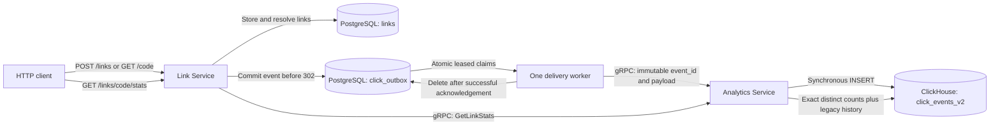

# LinkPulse

[](https://github.com/GrimVeqsum/LinkPulse/actions/workflows/ci.yml?query=branch%3Amain)

## 1. Project overview

LinkPulse is a Go URL shortener with durable, asynchronous click analytics. The HTTP service stores links and pending redirect events in PostgreSQL. A bounded worker delivers events over gRPC to the Analytics Service, which stores them in ClickHouse and provides statistics.

The project demonstrates request validation, database migrations, durable delivery, idempotent counting, dependency health checks, graceful shutdown, and real database integration tests. The original package layout and HTTP success contracts are retained.

## 2. Key features

- Six-character, cryptographically generated base62 codes with bounded collision retries.
- HTTP creation, redirect, and per-link statistics endpoints.
- PostgreSQL outbox committed before every successful redirect response.
- One serial delivery worker per Link Service process, leased claims, capped exponential retries, and safe shutdown.
- Immutable UUID event identity; exact distinct counts despite duplicate deliveries.
- UTC calendar-day statistics based on the original event timestamp.
- Bounded HTTP bodies, request/database/RPC deadlines, liveness and readiness checks.
- Additive embedded migrations, nonroot Docker runtime, isolated integration environment, and CI.

## 3. Tech stack

| Component | Implementation |
| --- | --- |
| Application | Go 1.25 minimum and CI (from `go.mod`); Docker toolchain 1.26.8 |
| HTTP | Standard library `net/http` |
| Link storage and outbox | PostgreSQL 17, pgx/v5 |
| Analytics storage | ClickHouse 26.8.6.5, clickhouse-go/v2 |
| Internal API | gRPC, Protocol Buffers |
| Schema management | Embedded SQL migrations with goose providers |
| Local infrastructure | Docker multi-stage builds and Docker Compose |
| Verification | Go testing, race detector, isolated database integration tests, GitHub Actions |

Dependency versions are recorded in `go.mod` and `go.sum`. No external web API is needed at runtime or by tests.

## 4. Architecture



`internal/link` contains the HTTP, service, and PostgreSQL layers. `internal/event` defines the immutable event payload; `internal/outbox` implements delivery. `internal/analytics` contains the gRPC client, server, and ClickHouse repository. `cmd` wires dependencies and owns process lifecycle. Generated protocol bindings live in `gen/analytics/v1`.

## 5. Event processing and reliability

1. Resolve the link and validate request metadata.
2. Generate a UUIDv4 and record the link, original UTC timestamp, User-Agent, and Referer in PostgreSQL.
3. Return `302 Found` only after the outbox insert succeeds. **If saving the event fails, return `503 Service Unavailable` without a Location header.**
4. The worker atomically claims due rows using `FOR UPDATE SKIP LOCKED`, assigns a lease token, and releases the database connection before making an RPC.
5. After a successful synchronous ClickHouse insert and RPC acknowledgement, delete the row only if its lease token still matches.
6. On RPC failure, keep the same ID and payload, record the error, and schedule a retry: 1, 2, 4, 8, 16, 32, then 60 seconds. Retries have no attempt limit. If claiming, acknowledging, or scheduling fails, the row remains recoverable after its lease expires.

Defaults: poll every 250 ms, claim up to 10 events, process serially, and allow 2 seconds per RPC. A batch lease is at least `batch_size * (delivery_timeout + 2s) + 5s`, or 45 seconds with defaults. Ownership checks prevent a stale worker from deleting a newly claimed event. Multiple Link Service instances can claim independently, although the default deployment runs one.

Delivery is **at least once**, conditional on eventual dependency recovery, valid persisted events, and sufficient durable storage. A process can die after ClickHouse commits and before PostgreSQL acknowledgement. Redelivery then creates another physical ClickHouse row. Statistics use `uniqExact(event_id)` and `uniqExactIf(...)`, so identical redeliveries count once immediately, without waiting for merges. Inserts explicitly disable asynchronous insertion. This is not an exactly-once delivery claim.

The supported statistic is the API result, not `count()` over the new raw table. UUIDs identify immutable events generated by the trusted Link Service; reusing an ID for different payloads through another internal caller is unsupported. Separate HTTP retries are separate events. A committed event may survive a client disconnect, so counts describe accepted redirect requests rather than proof that a browser visited the destination. Statistics lag while the outbox drains.

`today_clicks` uses `[00:00:00 UTC, next 00:00:00 UTC)` by original event time. A delayed event from yesterday increases total clicks but not today's clicks.

On SIGINT/SIGTERM, Link Service marks readiness unavailable, drains HTTP for up to 10 seconds, cancels and joins the worker, then closes dependencies. In-flight unacknowledged events stay leased until recovery. Analytics Service drains gRPC, with a forced stop after 10 seconds. Compose allows 25 seconds before sending a kill signal.

## 6. Database design

| Table | Purpose and key details |
| --- | --- |
| PostgreSQL `links` | BIGSERIAL ID, unique six-character code, target URL, creation timestamp. |
| PostgreSQL `click_outbox` | UUID primary key, link foreign key, immutable payload, attempt count, due time, lease token/expiry, latest error, creation time. Index on due/creation time. Delivered rows are deleted. |
| ClickHouse `click_events` | Original MergeTree table retained for historical data. Its rows have no event identity and contribute their original raw counts. |
| ClickHouse `click_events_v2` | New MergeTree table with UUID event identity and UTC DateTime64(3), partitioned monthly and ordered by link/event. Duplicate physical rows may exist. |

Existing `001` migrations remain unchanged. New `002` migrations add the outbox and the new analytics table. There is no destructive conversion or fabricated identity for legacy rows; legacy duplicates cannot be retroactively identified. All new inserts go to v2, and statistics add legacy counts to distinct new-event counts.

Migrations run at startup with a 30-second deadline. Each goose provider has its own filesystem and dialect; PostgreSQL migrations take an advisory lock. Bootstrap ClickHouse migrations from one Analytics Service instance at a time, since its DDL/version updates are not transactionally locked across processes. Existing database volumes and migration history are preserved.

To inspect a backlog without publishing PostgreSQL:

```bash
docker compose exec postgres psql -U postgres -d linkpulse -c \
  'SELECT count(*), min(created_at), max(attempts) FROM click_outbox;'
docker compose exec postgres psql -U postgres -d linkpulse -c \
  'SELECT event_id, attempts, available_at, last_error FROM click_outbox ORDER BY created_at LIMIT 10;'
```

## 7. API reference

| Method and path | Success | Failure behavior |
| --- | --- | --- |
| `POST /links` | `201` with `code`, `url`, `created_at` | `400` invalid JSON/URL; `413` body over 16 KiB; `503` canceled/timed-out database call; `500` other storage/generation failure. |
| `GET /{code}` | `302`, Location is the stored target; event already committed | `404` missing/invalid code; `400` invalid/oversized metadata; `503` outbox failure; `500` other lookup/generation failure. |
| `GET /links/{code}/stats` | `200` with `code`, `total_clicks`, `today_clicks` | `404` missing/invalid code; `503` unavailable analytics or database timeout; `500` other lookup failure. |
| `GET /health` | `200`, plain text `OK` | Liveness only; does not query dependencies. |
| `GET /ready` | `200`, plain text `OK` | `503` PostgreSQL unavailable or HTTP shutdown started. Analytics may be unavailable while redirects remain durable. |

Successful object responses use JSON; errors use plain text. Unsupported methods receive standard ServeMux responses. Go also serves HEAD for registered GET routes; a HEAD redirect records a request as well.

Creation accepts exactly one JSON object with one `url` string field. Duplicate/unknown fields, null, multiple objects, malformed JSON, and wrong types are rejected. URLs are trimmed, limited to 8192 bytes, and must be absolute HTTP/HTTPS with a valid hostname and optional port 1–65535. Credentials, whitespace/control characters, empty hosts, invalid bracketed addresses, and malformed ports are rejected. Local/private destinations are allowed; the service redirects and does not fetch URLs. Codes contain six ASCII letters/digits; `health` is reserved. User-Agent and Referer must each be valid UTF-8 and at most 4096 bytes.

Analytics exposes `TrackClick`, `GetLinkStats`, and standard gRPC health `Check`. Health reflects current ClickHouse availability. Invalid RPC payloads return `InvalidArgument`; storage failures return `Unavailable`, and context cancellation/deadlines retain their gRPC status. New events require a canonical UUIDv4 and a valid timestamp in ClickHouse's 1900–2299 range. Deploy the updated Analytics Service before the updated Link Service; older producers without event IDs are not supported by the new validator.

## 8. Quick start

Requires Docker Engine with a Compose version supporting `up --wait`. Standalone Go work requires Go 1.25 or later; CI reads the version from `go.mod` and disables automatic toolchain upgrades to verify that minimum. Docker builds use Go 1.26.8. The complete recovery smoke test additionally uses Python 3.

```bash
cp .env.example .env
docker compose config --quiet
docker compose up --build --wait
curl http://127.0.0.1:8080/health
curl http://127.0.0.1:8080/ready
```

Only `127.0.0.1:8080` is published by default. PostgreSQL, ClickHouse, and gRPC are reachable inside the Compose network. Startup applies embedded migrations. The runtime process uses UID/GID 10001.

```bash
docker compose logs -f link-service analytics-service
docker compose down
```

The second command stops containers and retains named database volumes. Existing volumes retain their original users/passwords; changing `.env` does not reset them. Local example credentials match the original Compose defaults and are demonstration values. Replace credentials for shared deployments. Do not commit `.env`.

## 9. Example requests and responses

```bash
curl -i -X POST http://127.0.0.1:8080/links \
  -H 'Content-Type: application/json' \
  -d '{"url":"https://example.org/docs"}'
```

Response shape (code and timestamp vary):

```http
HTTP/1.1 201 Created
Content-Type: application/json

{"code":"aB3xY9","url":"https://example.org/docs","created_at":"2026-10-27T10:00:00Z"}
```

Use the returned code and omit `-L` to inspect the redirect without contacting the destination:

```bash
curl -i http://127.0.0.1:8080/aB3xY9
curl http://127.0.0.1:8080/links/aB3xY9/stats
```

```http
HTTP/1.1 302 Found
Location: https://example.org/docs
```

Once the worker has delivered the event, a statistics response has this shape:

```json
{"code":"aB3xY9","total_clicks":1,"today_clicks":1}
```

These payloads illustrate the contract; they are not benchmark or verification output. Immediate statistics can still show zero because delivery is asynchronous.

## 10. Testing

Local checks:

The race detector requires CGO enabled and a C compiler (for example, GCC or Clang).

```bash
test -z "$(gofmt -l $(git ls-files '*.go'))"
go vet ./...
go test ./...
go test -race ./...
go build ./...
docker compose config --quiet
docker compose -f docker-compose.test.yml config --quiet
docker compose build
```

Unit tests cover code generation, collision retry/exhaustion, URL validation, HTTP contracts/failures, durable enqueue ordering, metadata validation, gRPC deadlines/errors, retry identity/backoff, lease sizing, cancellation, worker shutdown, configuration, and dynamic analytics health.

Run the isolated integration suite and full process recovery check:

```bash
./scripts/integration.sh
```

It uses `docker-compose.test.yml`, separate project `linkpulse-integration`, tmpfs databases, and HTTP port 18080. Set `TEST_PROJECT` and `TEST_HTTP_PORT` to avoid collisions with another test run. No developer database or persistent Docker volume is used. The script stops its own test containers on exit. The suite creates temporary PostgreSQL schemas and ClickHouse databases and fails on missing configuration instead of silently skipping.

Manual equivalent:

```bash
docker compose -p linkpulse-integration -f docker-compose.test.yml up --build --wait postgres clickhouse analytics-service link-service
docker compose -p linkpulse-integration -f docker-compose.test.yml run --build --rm tests
python3 scripts/smoke.py --project linkpulse-integration --port 18080
docker compose -p linkpulse-integration -f docker-compose.test.yml down --remove-orphans
```

Integration tests exercise real migrations, creation, redirects, persisted events, statistics, unavailable/recovered analytics, redelivery after a committed insert without acknowledgement, physical duplicates, stale lease fencing, concurrent redirects and claims, UTC midnight boundaries, historical data, persistence failure, and deployed binaries. The smoke script stops the actual Analytics container, accepts eight redirects, checks that all eight remain in PostgreSQL, restarts Analytics, and requires nine total unique clicks and an empty backlog.

GitHub Actions checks formatting, vet, unit tests, race detection, build, Compose validation, and runtime image builds. A separate Docker job runs integration tests and the outage/recovery smoke check. Actual local verification results and the initial findings are recorded in [docs/AUDIT.md](docs/AUDIT.md).

## 11. Configuration

| Variable | Default / requirement | Consumer |
| --- | --- | --- |
| `HTTP_PORT` | `8080`; numeric 1–65535 | Link binary |
| `POSTGRES_URL` | Required connection URL | Link binary |
| `ANALYTICS_GRPC_ADDR` | `localhost:9090`; host:port | Link binary |
| `GRPC_PORT` | `9090`; numeric 1–65535 | Analytics binary |
| `CLICKHOUSE_ADDR` | `localhost:9000`; host:port | Analytics binary |
| `CLICKHOUSE_DATABASE` | `linkpulse` | Analytics binary / Compose |
| `CLICKHOUSE_USER` | `default` in binary; `linkpulse` in Compose | Analytics binary / Compose |
| `CLICKHOUSE_PASSWORD` | Empty in binary; demo value in Compose | Analytics binary / Compose |
| `POSTGRES_USER`, `POSTGRES_PASSWORD`, `POSTGRES_DB` | `postgres`, `postgres`, `linkpulse` | Compose |
| `HTTP_BIND_PORT` | `8080` on loopback | Compose |
| `TEST_HTTP_PORT` | `18080` | Test Compose/script |
| `TEST_PROJECT` | `linkpulse-integration` | Integration script |

Compose sets service-to-service addresses explicitly. The native-process examples in `.env.example` assume separately provisioned local database/gRPC ports; main Compose deliberately does not publish these ports. Native binaries read environment variables, not `.env` files. With Compose's interpolated PostgreSQL connection URL, credentials must use URL-safe characters or percent encoding appropriate to the URL; the example values need no escaping.

Timeouts are deliberately fixed: HTTP header/read/write/idle 3s/5s/10s/60s, handler context 3s, database operation 2s, RPC 2s, startup/migrations 30s. HTTP headers are limited to 16 KiB, and gRPC input messages to 32 KiB. Link Service caps its PostgreSQL pool at 16 connections per process and uses a 3-second connection timeout; Analytics caps its ClickHouse pool at 10. Worker defaults are in `internal/outbox/worker.go`; they are not additional environment options.

For protocol changes, use `protoc` plus `protoc-gen-go` v1.36.11 and `protoc-gen-go-grpc` v1.6.2 (generated files are committed):

```bash
protoc -I . \
  --go_out=. --go_opt=module=linkpulse \
  --go-grpc_out=. --go-grpc_opt=module=linkpulse \
  proto/analytics.proto
```

Your compiler installation must include the standard protobuf imports.

## 12. Engineering trade-offs

- PostgreSQL outbox reuses the existing database and avoids introducing a broker, at the cost of a database write and additional latency on every redirect.
- Redirect availability depends on durable event persistence. This deliberately prefers accountable analytics over redirecting without a saved event.
- One serial worker is easy to bound and stop. This favors understandable failure behavior over high ingestion throughput; replicas can share leased work.
- Exact read-time deduplication costs memory proportional to distinct event IDs. [ReplacingMergeTree background merges do not guarantee immediate uniqueness](https://clickhouse.com/docs/en/engines/table-engines/mergetree-family/replacingmergetree); correctness here does not depend on them.
- A separate new-event table preserves existing data and migration compatibility. Historical duplicates remain indistinguishable.
- Readiness checks the dependency needed to accept durable redirects. Analytics failure is visible through gRPC health, logs, and stats `503`, while Link Service stays ready.

## 13. Known limitations

- No authentication, per-user ownership, rate limiting, destination reputation checks, link expiry, or click filtering. Bots, prefetches, HEAD requests, and client retries can produce distinct events. This is an open shortener, not a unique-visitor counter.
- Internal gRPC and development PostgreSQL connections use plaintext inside the Compose network. Shared deployments need an appropriate network/TLS boundary and secret management.
- No dead-letter queue or retry cutoff. Permanent delivery errors remain in the outbox; monitor backlog age, attempts, errors, and disk capacity. There is no built-in metrics endpoint or alerting service.
- New-event raw storage retains duplicate physical rows and has no retention policy. Large datasets need capacity planning and a measured aggregation/retention strategy.
- Database durability depends on PostgreSQL/ClickHouse storage and configuration. This single-node Compose stack does not provide replication, automated failover, or backups. Delivery cannot survive loss of the underlying durable storage.
- ClickHouse bootstrap migrations require one active migration runner. Integration tests verify isolated single-node operation; no load benchmark or distributed-cluster guarantee is claimed.
- The short-code space is finite; five collision attempts can fail. The API returns an error rather than overwriting an existing link.
